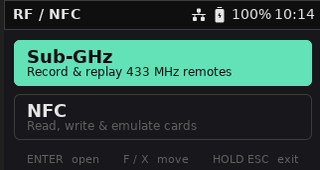

# ZeroRF-NFC

Two radio tools for the **M5Stack Cardputer Zero** (Raspberry Pi CM0, 320×170 screen, Linux),
built for the **Cap CC1101+NFC** expansion module. In the launcher it shows up as **RF / NFC**.



## What it does

- **Sub-GHz (433 MHz)** — record a 433 MHz remote (such as a garage opener), save it, and replay
  it, using the on-cap TI **CC1101** radio.
- **NFC (13.56 MHz)** — read, write and emulate 13.56 MHz cards, using the **ST25R3916** reader.

> **Fixed vs. rolling code.** Replaying a recorded remote works for **fixed-code** remotes
> (PT2262 and the like). Modern **rolling-code** remotes (KeeLoq) change their code every press
> and **cannot** be cloned by replay — that is by design, and this tool does not try to defeat it.
> It is meant for working with your own remotes and your own cards.

## Controls

- Arrows (**F / Z / X / C**, with or without **Fn**) move; **ENTER** opens a tool.
- **ESC** goes back to the menu; **hold ESC** to exit.
- **Fn+H** help, **Fn+J** screenshot, **T** toggles light/dark.

The interface is in English, like the other apps on the device.

## Build

Needs the tools in `Tools/Dockerfile` (CMake, an aarch64 cross-compiler, SDL2, …), or Docker.

```sh
Tools/compilar.sh pruebas     # build the desktop simulator (SDL2) and run the tests
Tools/compilar.sh deb         # build dist/ZeroRF-NFC_<version>_rev1_arm64.deb for the device
Tools/compilar.sh simulador   # build and open the simulator on this desktop (X11)
```

The first build downloads LVGL 9.5 and the M5Stack sysroot into `.cache/` (not versioned).

## Hardware

The Cap CC1101+NFC connects over the Cardputer Zero's SPI0 bus (`/dev/spidev0.1`). The CC1101
(Sub-GHz) and the ST25R3916 (NFC) share the SPI bus, so only one is used at a time. The cap's 5 V
rail is enabled through `/sys/class/leds/ext_5v_out/brightness`. See `CLAUDE.md` for the full pin
map and status.

## Status

**0.1.0 — working in the desktop simulator; not yet tested on the device.** Both tools are
functional against a *simulated* radio/reader:

- Sub-GHz: record → decode (Princeton/EV1527) → save (`.sub`, Flipper-compatible) → replay → delete.
- NFC: scan → show type / UID / NDEF → save (`.nfc`) → emulate → delete.

What remains needs the Cardputer: the real CC1101 and ST25R3916 drivers over SPI + libgpiod.

## License

MIT (see `LICENSE`). This may change to GPLv3 if code is ported from GPL-licensed projects
(e.g. Flipper Zero firmware); see the note in `CLAUDE.md`.
